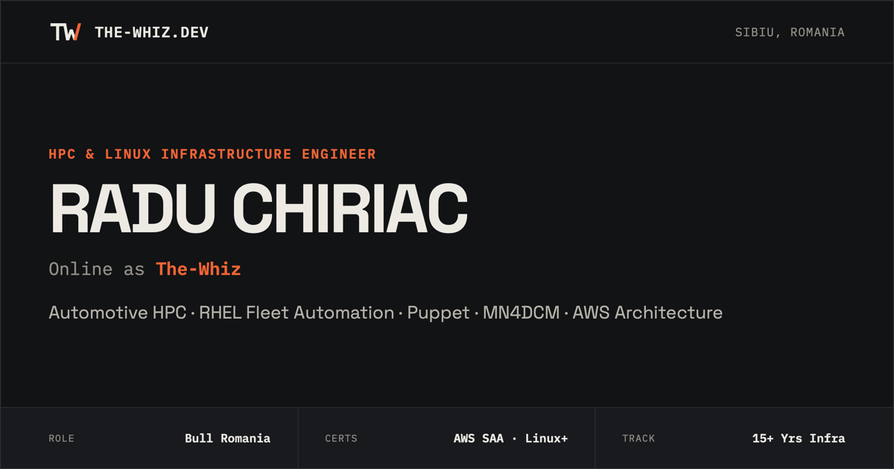

# the-whiz.dev



Source for [the-whiz.dev](https://the-whiz.dev), the personal website of **Radu Chiriac** (`The-Whiz`), HPC & Linux Infrastructure Engineer.

The site uses an industrial spec-sheet layout built on **Astro 7**, **Tailwind CSS v4**, and **Vercel**. Pages pre-render as static HTML and include an edge-cached Astro Server Island for live GitHub activity.

## Features

- Static-first pages (`/`, `/now`, `/colophon`, `/privacy`, `/404`) with native cross-document View Transitions.
- System-default Light and Dark theme (`prefers-color-scheme`) with zero first-paint flash and a `localStorage` toggle.
- Edge-cached Astro Server Island (`server:defer`) showing live GitHub public repo count, latest updated code repository, and a 52-week contribution trace with interactive bar inspection and static fallback.
- Interactive 5-layer infrastructure stack schematic and accessible `⌘K` (or `Ctrl+K`) quick-jump palette.
- Self-hosted typography (`Space Grotesk Variable` and `IBM Plex Mono`).
- Cookieless performance telemetry via `@vercel/speed-insights/astro`.

## Tech stack

- Framework: Astro 7 (`output: 'static'` with `@astrojs/vercel` and `@astrojs/sitemap`)
- Language: TypeScript (strict)
- Styling: Tailwind CSS v4 (`@tailwindcss/vite`)
- Typography: `@fontsource-variable/space-grotesk`, `@fontsource/ibm-plex-mono`
- Package manager: Bun
- Hosting and telemetry: Vercel and `@vercel/speed-insights`

## Local development

Prerequisite: Bun

```bash
bun install
bun run dev
```

Open `http://localhost:4321`.

## Scripts

- `bun run dev`: start the Astro development server
- `bun run check`: run Astro and TypeScript diagnostics (`astro check`)
- `bun run build`: run `astro check && astro build`
- `bun run preview`: preview the production build locally

## License

MIT. See [LICENSE](LICENSE).
